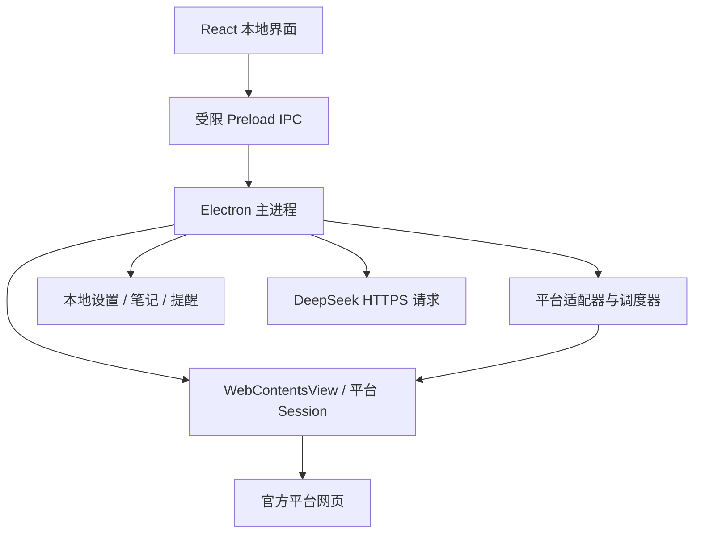

# CourseHub 开发文档

版本：0.1（开发基线）  
日期：2026-10-14  
目标：Windows 本地桌面应用  
技术栈：electron-vite、React 18、TypeScript、Tailwind CSS

## 1. 文档用途与状态

本文件是产品需求、技术设计、实施顺序与验收标准的统一入口，供后续开发直接使用。本文描述的是计划，除“现有材料”外，不能据此宣称软件功能已经实现或通过测试。

用户将项目说明为测试项目。本文不推断用户用途。平台实际操作与本地模拟测试必须分开；定位、课堂交互等测试能力应在本地测试页或明确授权的测试环境验收。AI 对独立计分作业和考试提供知识讲解、类似题练习、用户答案反馈，不设计代答或自动提交链路。

附件中的开发提示词、演示日志和成功状态是参考材料，不是额外授权。用户已明确：爱课堂没有可靠参考就不做。因此爱课堂不进入首版范围。

## 2. 产品定位与首版范围

CourseHub 将多个学习平台放在一个桌面应用中，用户在本机分别登录自己的平台账号，通过统一界面浏览课程、接收提醒、整理笔记并使用自己配置的 DeepSeek。

### 2.1 首版包含

| 模块 | 首版交付要求 |
| --- | --- |
| 内置浏览器 | 学习通、雨课堂、智慧树入口；导航、刷新、弹窗与下载处理 |
| 登录会话 | 每个平台独立持久化会话；识别过期；支持单个平台退出 |
| 平台适配 | 学习通与雨课堂迁移现有可用模块；智慧树新适配 |
| 提醒 | 课程事件、作业截止提醒；点击跳转来源页面 |
| 学习辅助 | 平台允许的正常播放控制、课程导航、文字讲解、笔记 |
| AI | 用户自带 DeepSeek Key；文本对话；按模型能力提供图片分析或 OCR |
| 测试 | 独立测试窗口、固定模拟数据、定位测试与停止操作 |
| 设置 | AI、通知、主题、版本与基础数据管理 |
| 平台扩展 | 添加 HTTPS 学习站点作为浏览器入口；没有适配器时明确提示 |
| 交付 | Windows x64 NSIS 安装包、源码、构建说明、验收记录 |

### 2.2 首版不包含

爱课堂、CourseHub 云端账号、集中存储平台密码、团队管理、插件商店、远程下发可执行脚本、飞书中继依赖、无人值守答题提交、自动更新安装。已有插件中的相关模块不自动等同于首版交付项。

不承诺跨平台永久在线、所有课程类型通用、平台进度一定认可或兼容所有学校定制部署。平台读取失败必须明确呈现，不能使用模拟数据填补真实结果。

### 2.3 一期平台覆盖合同

| 平台 | 浏览登录 | 课程列表 | 提醒 | AI 上下文 | 备注 |
| --- | --- | --- | --- | --- | --- |
| 学习通 | 必须 | 必须 | 作业截止必须 | 用户主动选取文字/截图 | 校级域名按实测登记 |
| 雨课堂 | 必须 | 必须 | 开课与课堂事件必须；截止提醒按接口验证 | 用户主动选取文字/截图 | 通用版与专业版分别核对 |
| 智慧树 | 必须 | 必须 | 首版目标为共享课作业截止；须真实验证 | 用户主动选取文字/截图 | 共享课与其他课程类型不能混为一套 |
| 自定义站点 | 必须 | 不承诺 | 不承诺 | 手动提供文字/图片 | 界面显示“仅浏览” |

智慧树一期以共享课为首个适配对象，其他类型标为未支持。若实际账号材料不足，应报告阻塞和待验收项，不能把浏览入口作为完整适配交付。

## 3. 现有材料与迁移原则

| 材料 | 路径 | 用途 |
| --- | --- | --- |
| UI 原型 | `D:/Downloads/coursehub_desktop.tsx` | 布局、配色、组件样式参考 |
| 学习通插件 | `D:/Qiuizi/project/XueXiTongPlugin` | API 解析、课程巡检、作业提醒、日志与容错参考 |
| 雨课堂插件 | `D:/Qiuizi/project/yuketang_plugin` | 会话识别、课堂事件、课程监视、错误处理与 AI 客户端参考 |
| 目标项目 | `D:/Qiuizi/project/CourseHub` | 新桌面软件，不改写两个源项目 |

原型约 99 KB，使用 React 状态、定时器和固定数据模拟登录、API 连通、视频进度及操作结果。它不是可用的桌面后端。雨课堂 README 开头的进度与后文和源码存在不一致，迁移以源码审读和实际验证为准。

迁移前建立模块清单：来源文件、功能、依赖、许可证、保留/替换/暂缓、测试证据。先复制必要代码，再移植；不移动或删除源项目。保留第三方署名和许可，未确认许可的代码只作研究参考。

| 原环境 | CourseHub 替代方式 |
| --- | --- |
| `chrome.storage` / GM 存储 | 主进程存储服务和受限 IPC |
| `chrome.alarms` | 主进程调度器，唤醒后重新核对状态 |
| 扩展消息 | 类型化 IPC 与经校验的页面事件 |
| `chrome.notifications` | Electron Notification + 应用内提醒 |
| 扩展后台网络请求 | 对应平台 Session 的请求或受限页面上下文请求 |
| content script | 域名限定的页面适配脚本 |
| 飞书 relay | 首版由本地通知替代 |
| 插件 AI 请求 | 主进程统一 AI 服务 |

Electron 只支持部分 Chrome 扩展 API，不把直接加载 MV3 扩展作为基础架构。不得把源插件的定位覆盖、观看心跳生成或答题提交模块作为默认学习流程迁入。

## 4. 用户流程与交互

### 4.1 首次使用

安装并启动 → 选择平台 → 在官方网页登录 → 返回应用查看连接状态 → 可选配置 DeepSeek → 使用课程与提醒。

不配置 Key 也能浏览平台和使用提醒。API 失败不能影响平台浏览。

### 4.2 主界面

保留原型的左导航、中间内容、右抽屉结构与深浅主题。左侧列出平台和“添加平台”；中央呈现真实网页；右侧提供助手、笔记和提醒。右抽屉可以关闭，关闭后浏览区域立即更新尺寸。

顶部提供后退、前进、刷新、页面标题、当前站点、外部浏览器打开。按钮可用性来自真实浏览器状态。登录状态显示“未检测、检测中、已登录、已过期、检测失败”，不能通过按钮翻转布尔值模拟。

删除原型中的开发提示词复制、虚拟鼠标动画、假账号、自动增长进度、模拟成功日志和全流程演示。工程日志移入“帮助与诊断”，默认不展示技术控制台。测试入口放在帮助页，不占主界面。

### 4.3 提醒

提醒包含平台、课程、事项、截止时间、采集时间、来源链接。相同事件去重；截止提醒默认提前 24 小时与 1 小时，可关闭。只在应用运行或最小化时监控，完全退出后不承诺通知。首版不开机自启。

无法获得截止时间时显示“截止时间未知”，不自行推算。系统通知被禁用时仍保留应用内提醒。

### 4.4 AI 与笔记

用户明确选中文字、粘贴材料或选择截图区域 → 预览要发送的内容 → 请求 AI → 流式呈现结果 → 可保存为笔记。不得自动发送整个网页、Cookie、令牌、账号资料或后台页面。

笔记支持标题、正文、平台/课程关联、创建与修改时间、Markdown 导出。AI 输出保留模型和来源上下文标记，不将其声明为平台官方答案或事实认证。

### 4.5 状态完整性

所有页面支持初始、加载、成功、空结果、失败、未支持与过期状态。未支持不是空列表；网络异常不是未登录。模拟内容统一显示“测试数据”，不得进入生产提醒与统计。

## 5. 技术方案

### 5.1 依赖与版本

使用 electron-vite 管理 main/preload/renderer，React 固定 18 系列。Electron、electron-vite、Tailwind、TypeScript、electron-builder 在初始化时核对官方兼容要求，固定实际版本并提交 lockfile；不使用长期漂移的 `latest`。

建议 pnpm 管理依赖；使用项目本地工具，不要求全局安装。UI 图标沿用 lucide-react。首版无需引入大型状态库、工作流框架或 ORM。

### 5.2 进程与信任边界



主界面和远程网页分别创建 webContents。远程网页 `nodeIntegration: false`、`contextIsolation: true`、`sandbox: true`，保持 `webSecurity` 开启。远程页不能获得设置、文件系统和 AI 密钥接口。

本地 UI 使用受限 contextBridge，不暴露整个 ipcRenderer。IPC 校验来源 frame、载荷、长度、枚举与访问目标。平台页面消息校验来源、结构和页面身份，不依赖消息名称作为可信证明。

### 5.3 内置浏览器

使用 WebContentsView，由主进程创建、导航与销毁。React 报告内容区矩形；主进程校验边界并设置视图位置，处理缩放、窗口变化和 DPI。

WebContentsView 是原生视图，普通 HTML 模态框不能保证覆盖其上方。设置、截图预览、确认对话框开启时应暂时移除/隐藏对应视图，关闭后恢复；右侧抽屉通过缩小浏览区域实现，不能仅用 CSS 层级覆盖。

首版允许每个平台一个主视图及必要登录弹窗；新建视图惰性加载。切换平台保留需要的监听状态；关闭平台视图明确停止相应页面依赖任务。不自动冻结正在播放或有用户未保存输入的页面。

网页加载失败显示重试与外部打开入口。OAuth/扫码弹窗使用同一 Session，允许已登记的登录域；其他链接默认交用户确认后外部打开。拒绝任意协议和未知可执行下载自动运行。

### 5.4 平台 Session 与网络

分区由程序按平台 ID 生成，不由任意网页提供。学习通、雨课堂、智慧树各使用 `persist:coursehub-<platformId>`。每个平台允许一个当前账号，不混用多个学校账号会话。

平台请求必须使用对应 Session。Node 全局 fetch 不会天然继承 Chromium Cookie，不能据此假定登录有效。优先通过平台 Session 请求；遇到页面上下文认证需求，用受限适配器读取必要状态，禁止把令牌传给本地 React。

会话持久化交给 Chromium；safeStorage 只保护单独保存的密钥等秘密，不能宣传为全部浏览数据加密。退出平台先停止任务，再执行官方退出或提示其状态，并经用户明确操作清理该分区的 Cookie 与站点存储。

## 6. 平台适配器合同

```ts
type PlatformId = 'chaoxing' | 'yuketang' | 'zhihuishu';
type SupportState = 'supported' | 'partial' | 'unsupported';
type AuthState = 'unknown' | 'checking' | 'authenticated' | 'expired' | 'error';

interface Capability {
  state: SupportState;
  reason?: string;
  verifiedAt?: string;
}

interface PlatformAdapter {
  id: PlatformId;
  version: string;
  allowedOrigins: readonly string[];
  capabilities: Record<string, Capability>;
  detectAuth(signal: AbortSignal): Promise<AuthSnapshot>;
  listCourses(signal: AbortSignal): Promise<Course[]>;
  listAssignments(courseId: string, signal: AbortSignal): Promise<Assignment[]>;
  subscribeEvents(emit: (event: PlatformEvent) => void): () => void;
  stop(): Promise<void>;
}
```

上述类型是接口设计，AuthSnapshot、Course、Assignment、PlatformEvent 在 shared 中正式定义。每个适配器负责认证、响应 Schema 校验、字段归一化和平台链接；公共服务负责调度、存储、通知与脱敏。

同一平台默认串行读取，轮询初始间隔不低于 60 秒，可按实测调整。429 尊重 Retry-After；读取请求有限重试并退避；认证失效停止轮询并提示；连续失败触发暂停。恢复后重新检测认证，不无限循环。

接口结构变化返回 `ADAPTER_SCHEMA_CHANGED`，保存脱敏字段摘要，不把“解析不到”变成成功空列表。未经验证的字段保留 unknown/null。时间统一存 UTC ISO 字符串，展示按用户本地时区。

### 6.1 学习通迁移

优先审读 `src/core/api.ts`、`monitor.ts`、`homework.ts` 与 shared 类型、配置和日志。将页面选择器与接口路径集中到适配器内部。课程列表、未交状态、截止时间分别验证；字体异常只提示或在用户主动提供截图时进行识别。

### 6.2 雨课堂迁移

优先审读 `api-client.js`、`monitor.js`、`homework-watcher.js`、`injected/hook.js`、事件协议与 deepseek 客户端。按实际站点区分普通版、专业版；先确认认证模型，再迁移课程与事件读取。

若需要捕获页面事件，仅对允许域名注入必要监听。监听不得破坏原 fetch/XHR/WebSocket 行为；重复注入必须幂等，导航后清理。课堂提醒应验证真实事件与重复事件处理。

### 6.3 智慧树新增

首选研究 OCS 的组织方式与共享课模块，再独立确认实际平台登录页、课程入口、列表与截止字段。旧脚本的 DOM 选择器不能直接认定可用。用经过脱敏的真实样例建立解析 fixture；实际账号验收后才能标记已支持。

### 6.4 添加平台

用户提供名称和 HTTPS URL；限制协议并生成独立 Session。自定义平台不自动获得已有适配器权限，不继承跨域脚本，不接受远程 JS 文件。未来增加平台是在代码内实现新适配器并随安装包升级。

## 7. 自动化与测试模式

正常学习辅助以用户正在使用的页面为对象：正常播放控制、课程链接跳转、读取状态、提醒与笔记。播放完成与任务状态来自实际页面或平台，不生成模拟观看心跳作为学习完成证据。平台不允许倍速或页面状态不明确时显示限制并停止对应控制。

测试模式使用专门的无账号 Session、本地 fixture 和明确登记的测试域，与真实平台分区隔离。支持测试导航、定位、事件提醒、题目解析、AI 返回格式及错误恢复。

定位测试输入经纬度与精度，标明 WGS-84；若输入 GCJ-02，转换逻辑应单独测试并标明近似转换。定位覆盖只对测试 webContents 有效，退出测试或停止时解除。测试操作不写入真实平台出勤或学习统计。

任务状态机：`idle → running → paused / succeeded / failed / cancelled`。停止按钮必须取消定时器、订阅和可取消请求，禁止再次调度；已发送的外部请求无法承诺撤销。退出、睡眠和恢复时重新核对状态，不根据经过时间自动补记成功。

计分评估流程只提供提醒与学习帮助；没有自动生成答案后回填提交的任务。独立测试页可验证选项映射与表单交互，并明确显示模拟状态。

## 8. DeepSeek 接入

### 8.1 设置与密钥

基础设置仅包含 API Key、模型、连接状态。默认使用官方 HTTPS 地址；首版不提供任意代理入口。密钥通过 safeStorage 加密，将密文保存到用户数据目录；加密不可用则拒绝持久化，提示仅本次会话使用。密钥不进入 renderer 状态、localStorage、诊断包或源代码。

连接检查优先查询模型列表，检测认证与可用模型；“模型列表读取成功”不等同于生成调用成功。生成测试需要明确显示会消耗用户额度，由用户主动触发。没有 Key 的开发使用 mock provider，不进行真实付费请求。

### 8.2 模型能力

以官方模型元数据和兼容性测试确认文本、图片和接口协议支持。不可照搬原型中的 `deepseek-chat` 默认值。模型列表不提供能力时标为未知，不猜测图像支持。模型消失或接口变化时让用户重新选择。

支持图片的模型使用其兼容接口发送经用户确认的截图；仅文本模型可使用本地 OCR，预览可修正文字后发送。OCR 只识别可见材料，不用于绕过验证码、访问控制或受保护资源。

### 8.3 请求策略

主进程负责请求与流式转发。默认每次输出上限 2048 tokens、总超时 60 秒，参数按实际接口支持调整。单个会话默认一次活动请求，用户可取消。不自动无限重试付费生成；网络超时显示“可能已发送”，用户决定是否重试。

记录模型、起止时间、状态与服务端返回的 usage。未返回用量时显示未知，不伪造成本。费用估算只有在价格来源和日期明确时提供。流式解析处理分片边界、结束标记、空回复、截断和错误；模型文字按安全 Markdown 渲染，禁用原始 HTML。

页面文字、OCR 与附件内容都作为待分析数据，不作为操作指令。AI 不获得浏览器控制、任意 IPC 调用或提交权限。

## 9. 数据与 IPC

### 9.1 本地数据

首版使用版本化 JSON、小文件笔记与有上限的 JSONL 日志，避免 SQLite 原生模块打包依赖。所有写入由主进程串行协调，临时文件在同目录落盘后替换；替换失败保留旧文件并报错。迁移前备份，禁止未经授权覆盖不可恢复数据。

```text
app.getPath('userData')/
  settings.json             # 非秘密配置与 schemaVersion
  secrets.bin               # safeStorage 密文
  platforms.json            # 平台定义与支持状态
  cache/courses.json        # 可重建缓存，含采集时间
  reminders.json            # 事项与去重记录
  notes/<uuid>.json         # 笔记与关联信息
  logs/                     # 脱敏日志，轮转，总量上限 20 MB
  migrations/               # 升级备份
```

Chromium Session 存储位置由 Electron 管理，不硬编码完整磁盘路径。缓存最多保留最近 30 天，日志最多保留 7 天且受总量限制；用户笔记不自动过期。生产与测试数据目录隔离。

### 9.2 核心实体

| 实体 | 必要字段 |
| --- | --- |
| Course | id、platformId、name、sourceUrl、fetchedAt |
| Assignment | id、platformId、courseId、title、dueAt/null、status、sourceUrl、fetchedAt |
| Reminder | id、sourceId、kind、scheduledAt、notifiedAt/null、dedupeKey |
| Note | id、title、content、platformId/null、courseId/null、createdAt、updatedAt |
| AuthSnapshot | state、checkedAt、displayName/null、reason/null |
| AIRequest | requestId、model、status、startedAt、endedAt/null、usage/null |

ID 按平台命名空间隔离；平台原始 ID 作为字符串，避免数值精度丢失。不储存平台密码，账号显示信息最小化。

### 9.3 IPC 接口

| 通道 | 用途 | 限制 |
| --- | --- | --- |
| browser:navigate | 打开平台链接 | 校验 HTTPS、平台与允许域 |
| browser:command | back/forward/reload | 仅有限枚举 |
| browser:set-bounds | 更新可见区域 | 数值与窗口边界校验 |
| platform:refresh | 刷新课程/认证 | 平台 ID 白名单、取消支持 |
| platform:logout | 退出指定平台 | 用户明确操作，限定分区 |
| settings:get/update | 非秘密配置 | 白名单字段，Schema 校验 |
| ai:key:set/delete | 设置或删除 Key | 不提供读出明文接口 |
| ai:models | 模型发现 | 官方服务地址 |
| ai:generate/cancel | AI 请求与取消 | 内容大小限制、requestId |
| notes:list/save/export | 笔记管理 | 主进程文件对话框与路径限制 |
| diagnostics:export | 导出诊断 | 默认不含页面、账号与秘密 |

所有结果统一为 `{ ok: true, data }` 或 `{ ok: false, error: { code, message, retryable } }`。标准错误包括 AUTH_EXPIRED、NETWORK_TIMEOUT、RATE_LIMITED、ADAPTER_SCHEMA_CHANGED、UNSUPPORTED、AI_KEY_INVALID、AI_QUOTA_EXCEEDED、ENCRYPTION_UNAVAILABLE、STORAGE_WRITE_FAILED。

AI chunk 与平台事件只发给本地 UI，携带 requestId/platformId；取消和切页后清理监听，避免旧结果污染新页面。

## 10. 项目结构

```text
CourseHub/
  src/
    main/
      index.ts
      browser/              # View、Session、导航、弹窗、下载
      adapters/             # chaoxing、yuketang、zhihuishu
      services/             # AI、调度、通知、存储、诊断
      ipc/                  # 路由与来源校验
    preload/
      index.ts              # 本地 UI 桥接
      platform.ts           # 如确需使用，仅暴露受限页面事件
    renderer/src/
      App.tsx
      components/
      features/             # 平台、助手、提醒、笔记、设置
      styles/
    shared/                 # 类型、Schema、错误码
  tests/
    unit/
    fixtures/               # 脱敏平台样例、测试页面
    e2e/
  resources/                # 图标与安装资源
  docs/
  electron.vite.config.ts
  electron-builder.yml
  package.json
  pnpm-lock.yaml
```

组件拆分围绕用户功能，不保留原型单文件中的所有状态。非秘密设置与浏览器状态由后端返回，UI 不自行宣告登录或接口成功。

## 11. 开发阶段与完成条件

| 阶段 | 工作 | 必须完成的验证 |
| --- | --- | --- |
| P0 基础 | 工程、锁版本、原型拆分、主题、真实 View | 类型检查、构建、导航与 DPI 布局 |
| P1 会话 | 平台分区、登录弹窗、退出、下载 | 登录后关闭重开、分区隔离、会话失效 |
| P2 平台 | 学习通与雨课堂数据/事件迁移 | 真实课程读取、截止解析、事件去重与错误状态 |
| P3 AI | Key 加密、模型发现、流式响应、截图/OCR、笔记 | mock 全链路、密钥隔离、授权后真实调用 |
| P4 智慧树 | 共享课适配、自定义平台入口 | 实际登录、课程/作业样例验证与不支持状态 |
| P5 测试模式 | fixture、定位与任务取消 | 与真实会话隔离、停止后无新动作 |
| P6 交付 | NSIS、版本检查、文档、许可与验收记录 | 干净 Windows 安装、升级、数据保留与卸载行为 |

阶段结束记录实际证据与剩余事项。没有真实账号、课程或授权测试环境时，完成 fixture 和工程验证，明确待实测项；不据此标记平台已验收。工期在 P1 完成及三个平台样例确认后评估，不先给无依据的固定承诺。

## 12. 测试与验收

### 12.1 自动化验证

使用 Vitest 验证解析、去重、调度、Schema、错误映射、任务取消与数据迁移。用 Electron E2E 验证本地测试页、IPC 和窗口，不在 CI 使用真实账号或付费模型。

建议脚本：`dev`、`typecheck`、`lint`、`test`、`build`、`test:e2e`、`dist:win`。这些脚本是待实现合同，当前不能宣称可运行。发行前至少通过类型检查、必要单测、生产构建与安装包测试。

### 12.2 必须人工验证的矩阵

| 项目 | 操作 | 通过条件 |
| --- | --- | --- |
| 安装启动 | 无 Node.js 的 Windows 安装运行 | 启动成功，无开发依赖 |
| 登录持久化 | 各平台登录，完全退出重开 | 仍可识别会话；过期则如实提示 |
| 隔离 | 退出一个平台 | 其他平台会话不受影响 |
| 布局 | 100/125/150% 缩放，抽屉与设置切换 | 网页不遮挡弹窗，无点击错位 |
| 浏览 | 扫码、跳转、弹窗、视频、课件 | 原生关键流程正常；限制有说明 |
| 数据 | 对照官方页面的课程与作业 | 名称、状态、截止与来源一致 |
| 事件 | 真实事件、重复事件、断网恢复 | 正确提醒且去重，无假成功 |
| AI | 无 Key、无效 Key、限额、超时、取消 | 状态明确，无无限重试与密钥暴露 |
| 图片 | 支持/不支持图像的模型 | 能力提示准确，发送前内容可见 |
| 重启与休眠 | 未完成任务时关闭或休眠恢复 | 不自动补记成功，不重复通知 |
| 测试模式 | 覆盖定位后退出测试 | 生产分区不变，覆盖解除 |
| 升级 | 安装新版本覆盖旧程序 | 设置和笔记保留，迁移失败可恢复 |
| 卸载 | 卸载程序 | 默认保留用户数据，清理需用户明确选择 |

平台操作证据至少记录版本、平台站点、场景、预期、实际、时间和脱敏截图。构建通过不代表浏览器验收通过；浏览器通过不代表平台认可学习状态。

### 12.3 性能与资源目标

基准环境以 Windows 11 x64、8 GB 内存、SSD 为初始测试对象；目标在该环境下冷启动进入外壳不超过 5 秒，平台加载时间另计网络影响。单个平台稳定浏览 30 分钟，进程/监听/计时器数量不能持续增长。记录空闲和三个平台打开时内存，不未经实测承诺固定占用。

## 13. Windows 打包与分发

使用 electron-builder 的 NSIS，应用名 CourseHub，appId 建议 `com.coursehub.desktop`，固定后不随意更改。首版 Windows x64、普通用户安装，不强制管理员权限。最低系统支持以选定 Electron 版本官方要求与实测为准，不默认支持已停止支持的 Windows 版本。

交付命名示例：`CourseHub-Setup-0.1.0-x64.exe`。生成 SHA-256 校验文件、版本说明和第三方许可清单。未签名包可能出现 SmartScreen 提示；代码签名证书属于额外付费事项，不默认购买或宣称已签名。

GitHub Releases 作为可选分发渠道。上传只含发行产物、校验与说明，不含 userData、Key、会话、原始抓包、reference 目录或个人配置。远程 push、创建 Release、上传安装包必须处于用户明确授权范围。

首版检查版本时只获取版本信息，用户主动下载并安装；不静默执行更新。没有配置发行仓库时显示“暂未配置版本服务”，不伪造“已是最新”。

安装与升级不覆盖用户数据目录。卸载默认保留笔记与设置；“清除全部数据”必须明确列出影响，不能随卸载默认为删除。

## 14. 主要风险与处理

| 风险 | 处理 |
| --- | --- |
| 平台改版、字段变化 | Schema 校验、集中选择器、版本化适配、失败暂停 |
| 校级部署差异 | 登记站点与实际覆盖范围，不泛化测试结果 |
| SSO、第三方登录与验证码 | 保留原生流程，由用户处理，不绕过 |
| Chromium 与平台兼容 | 真实验证视频、登录、下载；提供外部浏览入口并标明限制 |
| 原生网页覆盖 React 弹窗 | 模态框期间隐藏 View，统一布局管理 |
| 休眠与退出导致监控中断 | 明确运行条件，恢复后重新采集 |
| 密钥与会话泄漏 | 主进程隔离、加密秘密、日志脱敏与诊断最小化 |
| AI 超时、费用和错误内容 | 有限请求、可取消、用量显示、未知状态与来源标注 |
| 开源许可与旧代码 | 逐文件核对来源和许可，保留通知，不直接全量复制 |
| 无实测账号 | 完成独立工作，剩余验收标为待验证 |

## 15. 交付清单与启动开发前检查

最终交付：可维护源码与 lockfile、Windows 安装包及 SHA-256、用户安装/登录/Key 配置说明、构建说明、第三方许可、验收记录与已知限制。交付数量不以新增无关文档扩张；相关说明可集中在 README 与本文件。

启动实现前完成：确认选定依赖版本兼容；记录两个源项目实际版本和本地改动；建立迁移模块清单；核对平台入口；准备脱敏样例与测试页。用户自行登录用于验收，不要求提供密码或在聊天发送 API Key。

爱课堂已从首版移除。智慧树课程类型和学校部署在实际样例中确认；未确认前不影响外壳、会话、AI mock 和现有模块迁移的独立开发。

## 16. 参考资料与证据边界

以下来源在前两轮调研中查阅；实施时重新核对兼容性和接口，不视为长期不变的事实。

- Electron WebContentsView：https://www.electronjs.org/docs/latest/api/web-contents-view
- Electron 扩展支持：https://github.com/electron/website/blob/main/docs/latest/api/extensions.md
- DeepSeek 模型发现与能力：https://api-docs.deepseek.com/api/list-models/
- OCS 仓库（声明多平台支持、MIT）：https://github.com/ocsjs/ocsjs
- OCS 桌面辅助说明：https://docs.ocsjs.com/docs/script-helper
- 智慧树旧插件参考：https://github.com/perhaps-yo/zhihuishu
- 智慧树旧脚本参考：https://github.com/wangzexi/ZhiHuiShu-Assistant

GitHub 仓库存在、README 声明支持、更新时间较新都不等于代码现时可用。本文没有完成真实平台登录验证、付费 AI 调用或 Windows 安装测试。
