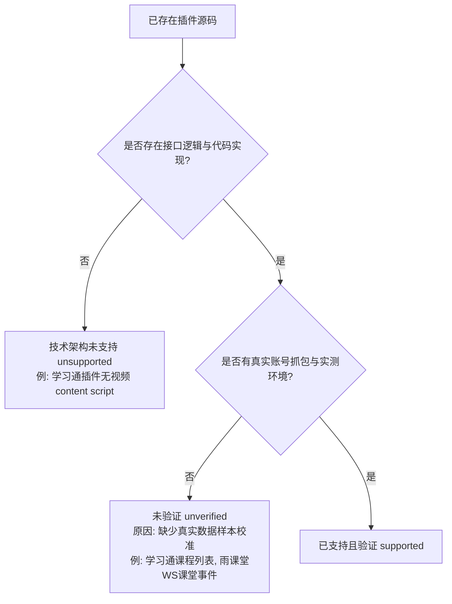

# CourseHub v0.3 功能边界与浏览器自动化测试规范

**文档状态**：需求理解修正与架构规范基线  
**制定日期**：2026-10-15  
**适用范围**：CourseHub 核心架构、内置浏览器（WebContentsView）、平台适配器、AI 辅助与测试子系统  

---

## 1. 需求理解纠正与核心原则

### 1.1 需求定位修正
在前期分析中，存在将双重用途（Dual-use）技术能力主观定性为违规行为的偏差。在此正式修正：
- **CourseHub 包含针对开发者自有网站及明确授权环境的浏览器自动化测试需求**。
- 自动化测试、定位模拟、焦点观测、表单自动填充及状态监控等属于标准的浏览器端到端（E2E）自动化与质量保障技术能力。
- 严禁在无事实证据的前提下推断用户主观意图，不再使用任何未经证明的定性措辞。

### 1.2 四维边界隔离模型
系统必须在架构、数据、运行时会话四个层次对操作场景进行严格解耦与边界约束：

| 维度 | 定义与范围 | 适用策略 | 行为限制 |
|---|---|---|---|
| **维度 1：技术能力本身** | Chromium CDP、DOM 提取、HTML5 媒体控制、多模态 LLM 分析、Web 模拟器 | 模块化纯函数与标准化 IPC | 具备通用性，保持技术中立 |
| **维度 2：自有/授权测试环境** | 本地 fixture（`file://`）、自建测试服务（`localhost`）、白名单自有域名 | 开放受控自动化、跑批测试、全流程闭环 | 仅在独立测试 Session 运行，带审计日志 |
| **维度 3：第三方生产环境** | 学习通、雨课堂、智慧树等在线教育平台官方网站 | 仅限用户辅助浏览、只读提醒、状态观测 | 严禁自动化提交、严禁伪造凭证或心跳 |
| **维度 4：未经授权或不实记录行为** | 生产打卡作弊、考试/计分作业代答提交、伪造观看记录刷课 | 架构级物理阻断 | 严禁将测试数据或模拟结果注入生产环境 |

---

## 2. 安全与隔离架构实施规范

为了确保自动化测试能力在自有环境中充分发挥，同时杜绝外溢到第三方生产环境，系统采用以下四大隔离支柱：

### 2.1 测试站点白名单（Allowed Origins Whitelist）
- **生产 Session**：严格按平台限定官方域名（如 `*.chaoxing.com`、`*.yuketang.cn`、`*.zhihuishu.com`），禁止跨域跳转与未知脚本。
- **测试 Session（Testbed）**：仅允许加载随包分发的本地 fixtures（`tests/fixtures/*.html`）及用户在设置中显式配置的自有测试域名（如 `http://localhost:*`、`http://127.0.0.1:*`、明确声明的测试子域）。
- **物理拦截**：主进程网络与导航事件层校验，任何测试指令如果目标非测试白名单，直接抛出 `SECURITY_DENIED` 异常。

### 2.2 独立持久化 Session（Partition Isolation）
- 生产环境与测试环境严格使用不同的 Chromium Session 分区：
  - 生产：`persist:coursehub-chaoxing`、`persist:coursehub-yuketang`、`persist:coursehub-zhihuishu`
  - 测试：`coursehub-test`（隔离无痕或独立测试持久化）
- Cookie、LocalStorage、Cache、ServiceWorker 物理隔离，测试过程产生的任何临时状态永不污染生产账号。

### 2.3 测试模式标识与 UI 警示（Testbed Mode Indicator）
- 当处于自有测试环境时，主界面及原生视图边界显式渲染“测试模式 · 隔离运行中”的水印与状态胶囊。
- 测试产生的题目结果、定位读数、视频进度明确标记为 `[TEST_FIXTURE]`，绝不汇总到日常学习动态或待办提醒中。

### 2.4 审计日志隔离（Audit Logging）
- 测试动作写入专属日志文件 `logs/testbed-audit.log`，记录：
  - 时间戳、测试用例 ID、目标 URL、下发动作类型（定位/播放/表单填充/可见性切换）、执行结果及耗时。
  - 审计日志脱敏记录，供回归分析与复盘使用。

---

## 3. 五大关键测试功能深度评估

### 3.1 Chromium Geolocation 定位模拟、地图选点与坐标变化测试
- **技术可行性**：
  - 基于 Chromium DevTools Protocol (CDP) 的 `Emulation.setGeolocationOverride` 和 `Emulation.clearGeolocationOverride` 实现精确经纬度与精度半径下发。
  - 结合 Leaflet 地图支持可视选点、手动输入、WGS-84/GCJ-02 转换校验及多点移动轨迹模拟。
- **使用边界**：
  - 仅在 `testbed` 独立的 WebContentsView 及测试白名单域名内生效。
  - 严禁将覆盖指令发送给生产平台 Session。
- **风险分析**：
  - 若注入到真实打卡系统，将产生虚假考勤记录；若清除机制不健全，可能导致浏览器会话坐标悬挂残留。
- **受控实现与替代设计**：
  - 必须提供“启动（start）- 观测对比（observe）- 停止（stop）- 紧急熔断（clearSync）”完整生命周期。
  - 双向验证：下发坐标后，通过测试页的 `navigator.geolocation.getCurrentPosition` 读取真实回显，验证误差小于量化容差才判定成功。
  - 退出测试页、场景切换、程序休眠或异常退出时，强制触发 `clearGeolocationOverride` 并 detach debugger。

### 3.2 visibilityState、页面焦点和视频播放状态相关测试
- **技术可行性**：
  - CDP 支持 `Page.setWebLifecycleState`（active / frozen / discarded）与 `Emulation.setFocusEmulationEnabled`。
  - 在测试环境的 DOM 上，可通过安全的测试代理探针分发 `visibilitychange`、`blur`、`focus` 自定义事件，验证播放器的生命周期响应。
- **使用边界**：
  - 仅用于自有测试站点中验证播放器在“切后台、窗口最小化、页面失焦”时的暂停（auto-pause）、续播（auto-resume）及心跳挂起机制。
  - 严禁在生产平台页面中注入反检测脚本（如强行覆写 `document.visibilityState = 'visible'` 绕过防挂机机制）。
- **风险分析**：
  - 在第三方生产平台破坏或绕过页面可见性检测属于违规规避行为，可能触发平台反作弊风控。
- **受控实现与替代设计**：
  - 在测试工作台中建立“页面状态模拟控制台”：提供 `Trigger Blur`、`Trigger Focus`、`Toggle Visibility (visible/hidden)` 控制按键。
  - 结合 `PlayerObserver` 观测器，实时捕获 `<video>` 元素的 `paused`、`currentTime` 变化，绘制“页面状态 - 播放状态”时序响应图，完成闭环验证。

### 3.3 DOM 题目识别、DeepSeek 多模态分析及测试表单自动化
- **技术可行性**：
  - DOM 结构提取：基于显式测试契约（`data-ch-*` 或测试页面标准表单选择器）提取单选、多选、判断、问答题目。
  - 多模态分析：截图通过 DeepSeek Vision 兼容接口或结合 OCR 解析图片题干，生成结构化 JSON 答案建议。
  - 表单自动化：由主进程校验操作白名单后，受控触发 DOM 点击或 CDP `Input.dispatchMouseEvent` / `Input.dispatchKeyEvent`。
- **使用边界**：
  - 自有测试站点：支持全自动化端到端测试（自动提取 -> AI 建议 -> 自动填充 -> 校验成功率）。
  - 第三方生产平台：严格限定为“只读学习辅助”——用户主动圈选文字/截图发起问答，AI 仅生成文字讲解与解题思路，不提供任何自动回填或自动提交接口。
- **风险分析**：
  - 生产环境中的自动代答与自动提交属于严重的学术不端违规行为，且模型幻觉可能导致非预期提交造成不可逆分数损失。
- **受控实现与替代设计**：
  - 权限分层：
    1. 感知层：只读提取题干结构。
    2. 规划层：生成规范化的 `TestActionPlan`（含题目 ID、拟选 key、填空文本、操作数硬上限）。
    3. 校验层：主进程校验选项合法性，拒绝非法越权。
    4. 执行层：测试模式下支持单步“预览（preview）”与“批量自动化（auto-run）”；生产模式直接关闭执行层通道。

### 3.4 视频任务播放、连续播放和状态观测
- **技术可行性**：
  - 基于 HTML5 标准 `<video>` 事件（`play`, `pause`, `timeupdate`, `ended`, `ratechange`）进行高保真观测。
  - 基于真实 `ended` 事件监听调度下一个视频任务，实现章节间的连续播放控制。
- **使用边界**：
  - 自有测试站点：用于验证视频课件播放器兼容性、缓冲机制、进度上报及多章节连播任务调度。
  - 第三方生产平台：支持合法的常规桌面播放辅助（正常起停、音量/静音、合规倍速 1.0x-2.0x、真实进度同步）；严禁伪造非实播的心跳包或直接修改后端时长。
- **风险分析**：
  - 伪造虚假观看心跳属于直接的数据造假；超常规倍速会触发平台风控判定为异常学时。
- **受控实现与替代设计**：
  - 纯真实的 DOM 驱动：绝不向服务器发送合成的离线进度包；一切进度以真实 `<video>` 播放推动为准。
  - 连续播放机制：设置 `ContinuousPlayQueue`，在测试环境下当且仅当接收到真实的 `ended` 事件且观测到 `currentTime >= duration` 时，才自动切换下一个 URL 并启动新一轮观测。

### 3.5 签到事件检测及自有测试站点的完整签到流程验证
- **技术可行性**：
  - 事件感知：通过轮询测试接口或 WebSocket 监听捕获活跃签到事件。
  - 自动化提交验证：针对不同签到类型（常规普通签到、手势密码签到、定位范围签到），在自有测试环境下自动组装测试参数并发起提交，验证服务端的校验逻辑。
- **使用边界**：
  - 自有测试站点：提供完整的“发起签到 -> 客户端接收 -> 自动化签到交互 -> 结果判定”闭环回归测试。
  - 第三方生产平台：仅实现只读的“签到巡检与桌面提醒”，提醒用户在手机或官方页面完成签到；严禁在生产平台中执行自动代签或伪造坐标签到。
- **风险分析**：
  - 真实平台的自动代签及异地打卡违背考勤真实性原则，存在纪律处分和账号冻结风险。
- **受控实现与替代设计**：
  - 在 `tests/fixtures/` 中构建完整的 `signin-test.html` 测试页，支持定位打卡、手势打卡交互。
  - 生产适配器中的 `submitSignIn` 保持 `unsupported`，测试台提供专属的 `testbed:submit-signin` 接口供自有测试闭环使用。

---

## 4. 现有插件复用性质澄清（学习通 / 雨课堂）

针对已有插件中涉及的能力，必须严格区分**技术实现存在性**与**真实数据验证状态**：

### 4.1 学习通插件（XueXiTongPlugin）真实状态
1. **课程与活动列表**：
   - 源码已实现端点：`mooc1-api.chaoxing.com/mycourse/backclazzdata` 与 `mobilelearn.chaoxing.com/v2/apis/active/student/activelist`。
   - **性质定位**：**实现已就绪，当前为 unverified**（由于无真实高校统一身份认证环境，尚未抓包校准，绝非技术上不可行）。
2. **视频与题目模块**：
   - **性质定位**：原扩展架构基于 background 轮询，未编写 content script 针对视频播放器与答题页面的 DOM 注入。因此在学习通适配器中标记为 **unsupported（功能未开发）**。

### 4.2 雨课堂插件（yuketang_plugin）真实状态
1. **认证与在课监视**：
   - 源码包含 `/api/v3/classroom/on-lesson-upcoming-exam`、WebSocket `/wsapp/` 抓包 Hook。
   - **性质定位**：**实现已就绪，当前为 unverified**（需要雨课堂真实开课流配合联调验证）。
2. **题目识别与 JSON 容错**：
   - 题目提取逻辑存在于 `answer-engine.js`，三级容错提取已成功移植到 `src/shared/deepseek.ts` 并通过 23 项单元测试。
   - **性质定位**：三级容错为 **supported**；雨课堂私有 API 题目字段映射为 **unverified**（需真实抓包确认）。
3. **视频与心跳**：
   - 原插件中存在从 presentation 提取播放地址的代码，但部分依赖未授权第三方参考。
   - **性质定位**：不直接迁入违规心跳生成器；播放器控制采用 HTML5 标准实现。

---

## 5. CourseHub v0.3 自动化测试能力补齐路线图

本轮实施严格遵守：**不删除已有代码、不进行无关重构、保持现有 116 项单测与 20 项 E2E 用例 100% 绿色**。

### 5.1 补齐模块一：测试台（Testbed）白名单与测试会话加固
1. 在 `PlatformConfig` 中为 `testbed` 扩展动态允许列表：支持 `http://localhost:*`、`http://127.0.0.1:*` 等本地测试服务，而不仅限于 `file://`。
2. 保持独立 `TEST_PARTITION = 'coursehub-test'`，在所有测试视图顶部注入醒目的测试标识。
3. 建立 `logs/testbed-audit.log` 审计记录器，记录每次测试调用参数与耗时。

### 5.2 补齐模块二：定位轨迹与坐标变化测试（Geo Suite 增强）
1. 在已有的 `GeoTestManager` 基础上，增加 **坐标连续变化 / 轨迹模拟测试接口**（`geo-test:simulate-route`）。
2. 支持设定起点、终点、步长与间隔，模拟移动设备在测试环境中的坐标变化过程。
3. 保持启动、读回比对、停止时清理的三步闭环。

### 5.3 补齐模块三：页面生命周期与可见性测试控制台（Visibility Lab）
1. 在主进程中注册 `testbed:set-visibility`（基于 CDP `Page.setWebLifecycleState`）与 `testbed:set-focus`。
2. 在 `tests/fixtures/video-task.html` 中增加事件监听器，可视化输出 `document.visibilityState`、`window.onblur`、`window.onfocus` 及播放器响应。
3. 验证播放器在后台运行时的状态机切换（如失焦自动暂停、回焦自动播放等测试场景）。

### 5.4 补齐模块四：视频连续播放自动化测试（Video Continuous Runner）
1. 在 `video-task.html` 中扩展多任务播放列表（Episode 1, Episode 2, Episode 3）。
2. 完善 `video:start-continuous` 调度器：监听主播放器 `ended` 事件，在真实播放完成时自动推进并无缝切换下一视频。
3. 观测并记录完整的“播放 -> 推进 -> 连播 -> 队列结束”状态转移日志。

### 5.5 补齐模块五：题目识别、DeepSeek 分析与表单自动化（Quiz Auto-Runner）
1. 在 `classroom-questions.html` 中保留现有的单选、多选、文本四种题型。
2. 在渲染进程 `QuizScene` / `TestbedScene` 中提供两档测试模式：
   - **单步受控模式**：提取题目 -> 生成建议 -> 用户确认 -> 执行单步填选。
   - **自动化回归测试模式**：一键触发全套题目的提取、AI 生成、自动填选、结果校验与得分报告。

### 5.6 补齐模块六：自有测试站点签到闭环（Sign-in Suite）
1. 新增 `tests/fixtures/signin-test.html` fixture 页面，模拟完整的前端签到组件（含手势画布、普通打卡按钮、地理位置打卡区域）。
2. 实现 `testbed:run-signin-test` 自动化接口：
   - 触发签到事件广播。
   - 自动化填充签到表单。
   - 校验测试服务器/页面的响应状态。
   - 生成完整的签到流程测试报告。

---

## 6. 总结
本规范确立了 CourseHub 在浏览器自动化测试领域的合规技术边界：**以受控白名单、独立 Session、审计日志为屏障，在自有和授权测试环境中完整发挥自动化测试威力，在第三方生产环境中坚守辅助浏览与只读提醒的底线**。后续开发将按照上述路线图稳步推进，确保每项测试能力都有据可依、可控可验。
